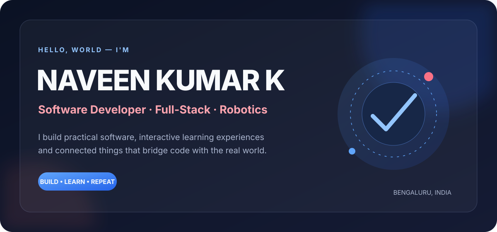
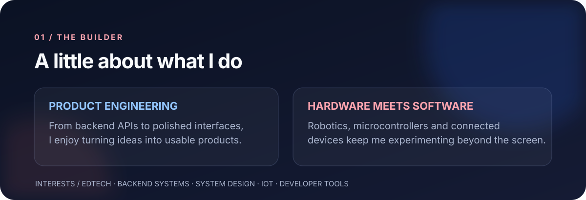
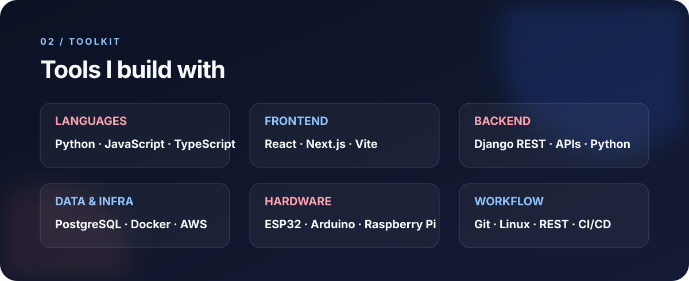
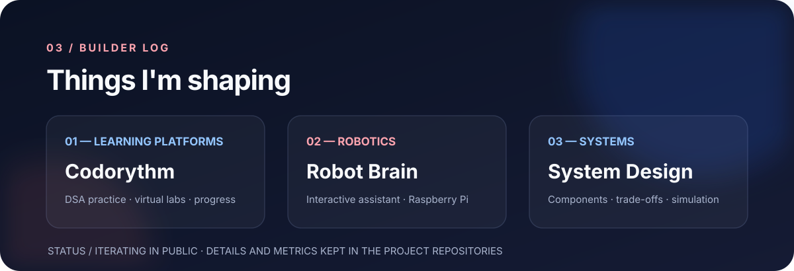
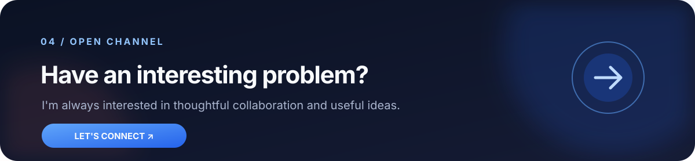

<!--
  PERSONALIZE BEFORE PUBLISHING:
  - Confirm your GitHub username and profile links.
  - Add your portrait to assets/profile.png if you want one in the dashboard.
  - Replace any project URLs or descriptions that have changed.
  This is an independently authored design inspired by the visual direction
  of the reference project; it does not reuse its SVG artwork or embedded photos.
-->

  

  
  
  

## Selected builds

| Project | What I'm building | Focus |
|:--|:--|:--|
| [**Codorythm**](https://codorythm.com/) | An interactive DSA learning platform with algorithm labs, quizzes, coding practice and progress tracking | EdTech · DSA · Full-stack |
| [**Robot Brain**](https://github.com/Naveenkumar2313/robot-brain) | Experiments and software for an interactive robotics assistant | Python · Raspberry Pi · Robotics |
| **System Design Playground** | A learning environment for exploring components, architecture decisions and system behaviour | System design · Simulation |

## Currently exploring

- Making technical learning more visual, interactive and measurable.
- Building practical system-design simulations rather than static diagrams.
- Connecting software with physical computing through ESP32 and Raspberry Pi.
- Improving backend reliability, performance and developer experience.

  <a href="https://github.com/Naveenkumar2313">GitHub</a>
  &nbsp;·&nbsp;
  <a href="https://codorythm.com/">Codorythm</a>
  &nbsp;·&nbsp;
  <a href="https://github.com/Naveenkumar2313/robot-brain">Robot Brain</a>
  &nbsp;·&nbsp;
  <a href="https://www.linkedin.com/">LinkedIn — replace with your profile URL</a>

Curious by default. Building, breaking and learning in public.

