# Render Lab — Camo Feature Test Bench

Target renderer: GitHub Markdown via camo image proxy (``).

---

### 01. SMIL Opacity and Transform
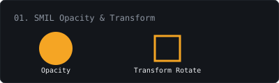

### 02. SMIL animateMotion
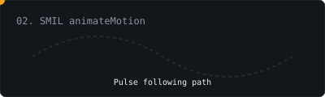

### 03. SMIL Path d-Attribute Morph
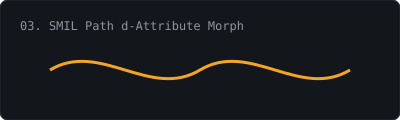

### 04. CSS Keyframes in Style Block
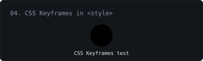

### 05. @font-face Data-URI WOFF2
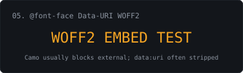

### 06. Embedded Raster (PNG and WebP)
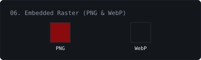

### 07. Filters (feGaussianBlur and feColorMatrix)
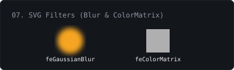

### 08. clipPath and mask
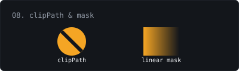

### 09. Dark/Light Theme Switching via `<picture>`
<picture>
  <source media="(prefers-color-scheme: dark)" srcset="09-dark.svg">
  <source media="(prefers-color-scheme: light)" srcset="09-light.svg">
  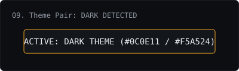
</picture>

### 10. prefers-reduced-motion
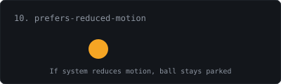

### 11. Cache Busting (?v=N)

### 12. Outlined Vector Text
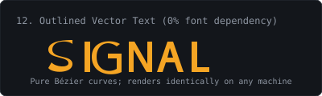

### 13. File Size: 300 KB
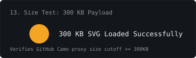

### 14. File Size: 800 KB
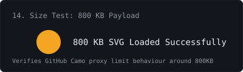
